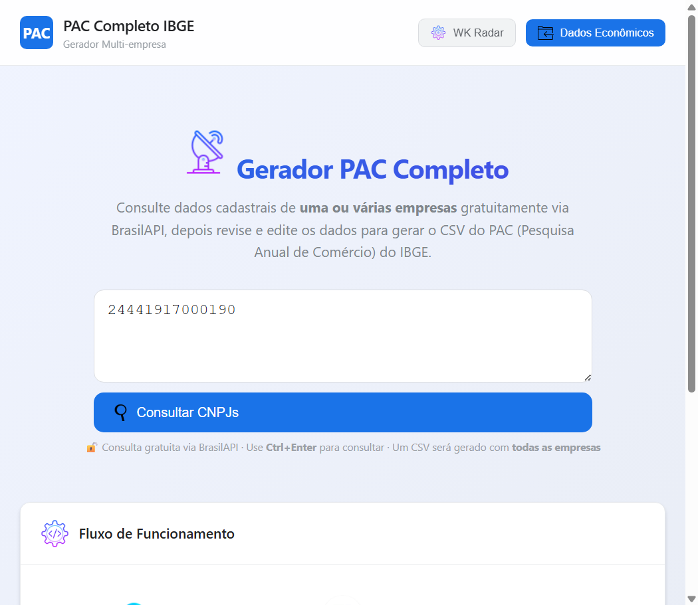
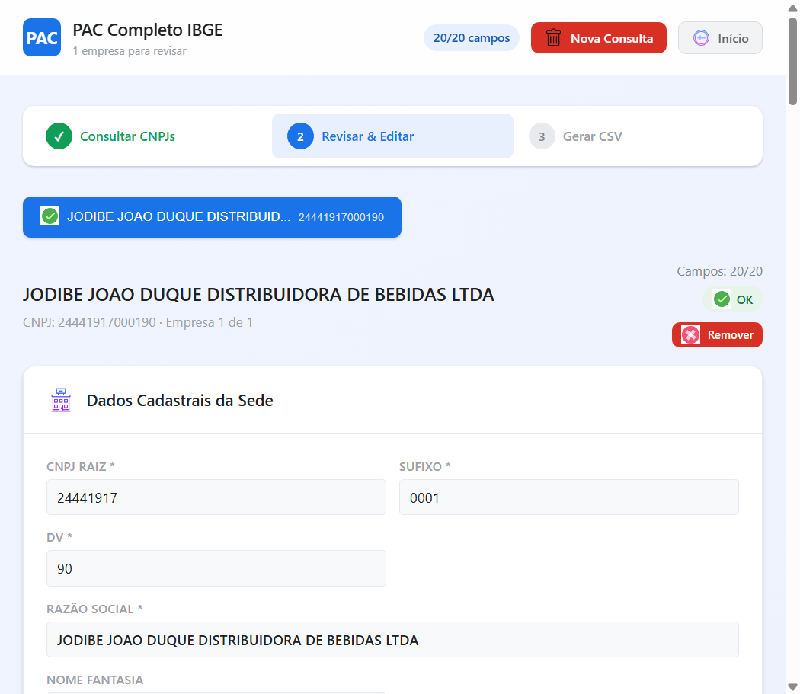

# 📊 Gerador PAC Completo IBGE

<div align="center">


[](https://pac-completo-ibge.vercel.app)

### 🚀 **Sistema rodando ao vivo!**
👉 **[https://pac-completo-ibge.vercel.app](https://pac-completo-ibge.vercel.app)** 👈

</div>

---

## 📸 Preview

<div align="center">

### Página Inicial — Consulta de CNPJs



### Editor Multi-Empresa com Abas



</div>

---

## ✨ Funcionalidades

| Funcionalidade | Descrição |
|---|---|
| 🔍 **Consulta Automática** | Digite um ou vários CNPJs — dados cadastrais preenchidos automaticamente via BrasilAPI |
| 🏢 **Multi-Empresa** | Suporte a lote de CNPJs com navegação por abas e CSV único |
| 📊 **WK Radar** | Integração opcional para dados financeiros (balancete/DRE) |
| ✏️ **Editor Completo** | Todos os campos do layout IBGE com validação em tempo real |
| 📥 **Upload Econômico** | Importe dados de CSV/Excel com códigos econômicos |
| 📄 **CSV Padrão IBGE** | Geração em ANSI, delimitador `;`, CRLF, sem aspas |

---

## 🚀 Deploy no Vercel

### Pré-requisitos

- [Node.js](https://nodejs.org/) (18+)
- [Vercel CLI](https://vercel.com/docs/cli): `npm i -g vercel`
- Conta gratuita no [Vercel](https://vercel.com)

### Passo a passo

#### 1. Criar repositório no GitHub

```bash
# No diretório do projeto
git init
git add .
git commit -m "Initial commit"

# Crie um repositório no GitHub e depois:
git remote add origin https://github.com/SEU_USUARIO/pac-completo-ibge.git
git push -u origin master
```

#### 2. Fazer login no Vercel

```bash
vercel login
```

#### 3. Fazer deploy

```bash
# Deploy de produção (vinculado ao GitHub)
vercel --prod

# Ou siga o assistente interativo:
vercel
```

**Importante:** Na primeira vez, o Vercel vai perguntar:
- `Set up and deploy?` → `Y`
- `Which scope?` → Selecione sua conta
- `Link to existing project?` → `N`
- `Project name?` → `pac-completo-ibge` (ou outro nome)
- `Directory?` → `.` (pressione Enter)
- `Override settings?` → `N`

#### 4. Conectar ao GitHub (deploy automático)

Após o primeiro deploy manual, acesse o [Dashboard do Vercel](https://vercel.com), vá em **Settings > Git** e conecte seu repositório GitHub. Assim, **cada push na branch `master` faz deploy automático**.

---

## 🖥️ Desenvolvimento Local

```bash
php -S localhost:8000
```

Abra [http://localhost:8000](http://localhost:8000)

---

## 📁 Estrutura do Projeto

```
preenche_pac_completo/
│
├── api/
│   └── index.php              # Entry point principal (Vercel + local)
├── index.php                   # Redireciona para api/index.php
├── vercel.json                 # Configuração do Vercel (runtime PHP)
├── .vercelignore               # Arquivos ignorados no upload Vercel
├── .gitignore
├── composer.json
│
├── src/
│   ├── PACLayout.php           # Layout oficial das colunas do PAC
│   ├── PACValidator.php        # Validação e mapeamento dos campos
│   ├── PACGenerator.php        # Geração do CSV (ANSI, ;, CRLF, sem aspas)
│   ├── BrasilAPI.php           # Cliente para consulta de CNPJ
│   ├── WKRadar.php             # Cliente para balancete financeiro
│   └── PACDadosEconomicos.php  # Parse de dados econômicos
│
├── assets/
│   ├── style.css               # Estilização moderna e responsiva
│   ├── script.js               # Interatividade no navegador
│   └── img/                    # Imagens e screenshots do projeto
│
├── wk_contas_config.json       # Mapeamento de contas do WK Radar
├── .github/workflows/ci.yml    # GitHub Actions (CI automática)
└── README.md                   # Este manual
```

---

## 🔧 Requisitos

- **PHP 8.0+** (testado no PHP 8.5)
- Extensões: `curl`, `json`, `session`, `mbstring`
- Navegador moderno (Chrome, Firefox, Edge)

---

## ⚙️ Configuração

### WK Radar (Opcional)

1. Clique em **⚙️ WK Radar** no topo da página
2. Cole seu token da API
3. Clique em **🔗 Testar Conexão** para verificar

O arquivo `wk_contas_config.json` contém o mapeamento entre as contas contábeis do WK Radar e os campos do PAC. Edite-o conforme seu plano de contas.

### Personalização do Layout

O layout das colunas segue o **template oficial extraído do Questionário Eletrônico do IBGE**. Se o layout mudar, edite `src/PACLayout.php`.

---

## 🌐 API BrasilAPI

Campos preenchidos automaticamente pela BrasilAPI:

| Campo | Origem |
|-------|--------|
| CNPJ (raiz, sufixo, DV) | ✅ Automático |
| Razão Social | ✅ Automático |
| Nome Fantasia | ✅ Automático |
| UF, Município | ✅ Automático |
| Endereço completo | ✅ Automático |
| CEP, Telefone, E-mail | ✅ Automático |
| CNAE e atividade | ✅ Automático |
| Situação cadastral | ✅ Automático |
| Site, Redes Sociais | ❌ Manual |
| Responsável | ❌ Manual |
| Forma de Tributação | ❌ Manual |
| Pessoal, Receitas, Despesas | ❌ Manual ou WK Radar |

---

## 📄 Formato do CSV Gerado

- **Codificação:** ANSI (Windows-1252)
- **Delimitador:** `;` (ponto e vírgula)
- **Sem cabeçalho** (apenas dados)
- **Sem aspas** nos valores
- **CRLF** no final de cada linha
- **Valores numéricos** sem separador de milhar
- Ordem das colunas conforme layout oficial do IBGE

---

## 🐛 Solução de Problemas

### BrasilAPI retorna erro

O sistema tenta novamente automaticamente até 3 vezes com intervalo progressivo. Se persistir, aguarde alguns segundos e tente novamente.

### WK Radar não conecta

1. Verifique se o token está correto
2. Verifique a URL base da API em `src/WKRadar.php`
3. Verifique se o balancete do ano existe no sistema

### Sessão expirou no Vercel (cold start)

O Vercel pode reciclar instâncias do servidor. Se ao carregar a página de edição aparecer "Nenhuma empresa carregada", basta fazer uma nova consulta dos CNPJs.

### CSV não importa no IBGE

1. ⚠️ **O arquivo deve estar em ANSI (Windows-1252)** — o sistema já gera assim
2. **Delimitador `;`** (ponto e virgula)
3. **Sem BOM** no início do arquivo
4. **Sem aspas** ao redor dos valores
5. **CRLF** no final das linhas
6. Compare a ordem das colunas com o template do seu QE

### Para obter o layout oficial

1. Abra o Questionário Eletrônico do IBGE
2. Vá em **Ferramentas → Importar Questionário**
3. Exporte o arquivo modelo e me envie para ajustar o sistema

---

## 🔄 GitHub Actions

A cada push, o GitHub Actions executa automaticamente:
- ✅ Validação do `composer.json`
- ✅ Syntax check de todos os arquivos PHP
- ✅ Syntax check de todos os arquivos JS

---

## 📝 Licença

Uso interno. Projeto desenvolvido para automação do preenchimento do PAC Completo do IBGE.
